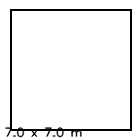

# car_slam_lap —— 小车「建图 + 走一圈」练习场

> **这是干嘛的**：拿现成的 C8T6 双驱底盘 + RDK X5 + Odin1，跑通
> **房间建图 → 重定位 → 小车自己走一圈** 这条完整链路，为之后调比赛机器人打基础。
>
> **当前状态**（2026-10-21）：
> - ✅ 链路协议（C + Python 双端，黄金向量测试通过）
> - ✅ X5 侧全部 ROS2 节点、配置、脚本、部署
> - ✅ 固件：USART1=X5、USART2=遥控器、**CAN1=SN65HVD230**、10 ms 仲裁、看门狗
> - ✅ 2026-10-21 按实物原理图修正：CAN 是 **裸收发器**，不是串口转CAN模块；
>   接线见 [WIRING.md](WIRING.md)
> - ⬜ **烧写 + 上车验证**（Keil 工程已能 0 error 编译，见 [§9](#9-固件状态与烧写)）

---

## 0. 链路拓扑（2026-10-21 按实物修正）

```
Odin1 ──USB3──► RDK X5 ──40pin 8/10──► C8T6 USART1 (PA10/PA9)
                  ▲                        │
                  │ 10 Hz status           │ CAN1 PA12/PA11 (500K)
                  └────────────────────────┤
                                           ▼
                                    SN65HVD230（3.3V 收发器）
                                           │ CANH/CANL
                                           ▼
                                    XHSMCUW50 双驱
DT7 ──USART2 (PA3, 100000 8E1)────────────► C8T6
（手动/急停，s2 打到底 = 硬急停）
```

**2026-10-21 修正**：实物是一块 SN65HVD230 裸收发器（`CAN收发器原理图.pdf`），
不是「串口转CAN 模块」。它没有 UART，**不能接 USART3**；电机链路走片内 CAN1。
完整接线见 [WIRING.md](WIRING.md)。

| 口 | 引脚 | 参数 | 对端 |
| :--- | :--- | :--- | :--- |
| USART1 | PA9 / PA10 | 115200 8N1 | RDK X5 40pin 第 8/10 脚 |
| USART2 | PA2 / PA3 | **100000 8E1** | DT7 接收机（DBUS） |
| CAN1 | PA12 / PA11 | **500 kbit/s** | SN65HVD230 → XHSMCUW50 |
| USART3 | PB10 / PB11 | 115200 8N1 | **备用/调试，不接电机** |

> `printf` 已经改成丢弃：两个在用串口都不允许混入调试文本。诊断走 10 Hz 的
> status 帧（X5 侧 `/car/status`）。

---

## 1. 目录

```
car_slam_lap/
├─ firmware/C8T6_DT7_car/               Keil 工程
│   ├─ Core/                            CubeMX 生成（usart.c 三路参数 + CAN 500K，.ioc 同步）
│   └─ Hardware/
│       ├─ LINK/protocol.c,h            X5 链路帧编解码（HAL 无关，PC 可测）
│       ├─ LINK/x5_link.c,h             USART1 收帧 + 10 Hz status
│       ├─ CAN/can_frame.c,h            混控帧编码（HAL 无关，PC 可测）
│       ├─ CAN/can_bus.c,h              CAN1 发送 + ACK 解析
│       └─ UART/{uart_rx.c,DBUS.c}      唯一的接收中断入口 + DT7 解码
├─ tests/
│   ├─ protocol_test.c                  70 项：CRC/布局/重同步/坏帧/黄金向量
│   ├─ can_frame_test.c                 12 项：混控帧黄金向量
│   ├─ hal_stub/                        PC 上的极简 HAL 替身（只做语法/类型检查）
│   ├─ check_keil_project.py            工程一致性：文件挂没挂、include、.ioc 参数
│   └─ run_tests.ps1                    一键跑全部离线检查
├─ x5/
│   ├─ car_bridge/                      ROS2 包
│   │   ├─ car_bridge/protocol.py       与固件同源的帧实现
│   │   ├─ car_bridge/path_io.py        轨迹文件读写 + 几何（不依赖 ROS）
│   │   ├─ car_bridge/bridge_node.py    /cmd_vel → 串口，回读 /car/status
│   │   ├─ car_bridge/link_test.py      链路自检（含看门狗验证）
│   │   ├─ car_bridge/teleop_keys.py    键盘遥控
│   │   ├─ car_bridge/record_path.py    建图时录轨迹
│   │   ├─ car_bridge/follow_path.py    纯追踪回放走一圈
│   │   ├─ car_bridge/map_from_cloud.py 点云累积成 PCD + 俯视图
│   │   ├─ car_bridge/calibrate_speed.py 实测 m/s 与指令的换算
│   │   └─ test/                        协议黄金向量 + 轨迹往返测试
│   ├─ config/                          Odin1 建图 / 重定位两份配置
│   ├─ scripts/                         板端脚本（安装/探测/建图/存图/重定位/走圈）
│   └─ pc/deploy.ps1                    打包 + pscp + 远程安装
├─ WIRING.md                            接线/电源/上电顺序（先看这个）
└─ README.md
```

---

## 2. 接线（详细版见 [WIRING.md](WIRING.md)）

| 连接 | 细节 | 注意 |
| :--- | :--- | :--- |
| X5 40pin ↔ C8T6 USART1 | 8(TX)→**PA10**(RX)；10(RX)→**PA9**(TX)；GND 互连 | **必须交叉**；3.3V 电平 |
| DT7 接收机 ↔ C8T6 USART2 | PA3(RX)，5V/GND；100000 8E1 | s2 打到底 = 硬急停 |
| C8T6 CAN1 ↔ SN65HVD230 | PA12→H1-4(D)；PA11←H1-3(R)；3V3→H1-2；GND→H1-1 | **不是 USART3**；H1 顺序以原理图为准 |
| 收发器 ↔ 控制器 | H2-1 CANH→J3-1；H2-2 CANL→J3-2；GND→J3-6/7 | 双绞；板载 120Ω，两端合计约 60Ω |
| 控制器开机/急停 | J3-11 PowerKey 对 J3-10 短接 1 s；J3-12 Break 低=急停 | 不按 PowerKey 控制器不上电 |
| Odin1 ↔ X5 | Type-C→**蓝色 USB3 口**；12V/2A 航插 | Type-C 不供电 |

上电顺序：先逻辑（C8T6/X5/Odin1），再按 PowerKey 开控制器。CAN 不需要 `S5/O`
初始化——SN65HVD230 是纯硬件收发器，固件直接 `HAL_CAN_Start`。

---

## 3. 两层协议

### 3.1 X5 ↔ C8T6（二进制帧，115200 8N1）

**下行 X5 → C8T6，50 Hz，9 字节**

```
+------+------+-----+-----+-----------+-----------+------+
| 0xA5 | 0x5A | LEN | CMD | speed i16 | angular   | CRC8 |
|      |      | 0x05| 0x01| LE        | i16 LE    |      |
+------+------+-----+-----+-----------+-----------+------+
                          [-1000,1000] [-1000,1000]
```

**上行 C8T6 → X5，10 Hz，7 字节**

```
+------+------+-----+-----+--------+-----+------+
| 0x5A | 0xA5 | LEN | CMD | status | src | CRC8 |
|      |      | 0x03| 0x81|  位    | 0-2 |      |
+------+------+-----+-----+--------+-----+------+
```

- `speed > 0` 前进，`angular > 0` 右转
- `status`：b0 CAN 帧进邮箱（**只代表 HAL 接受，不代表控制器收到**）/
  b1 串口在线 / b2 遥控在线 / b3 急停 / **b4 收到控制器 ACK（真实总线证据）**
- `src`：0 无 / 1 串口 / 2 遥控
- **CRC8 = poly 0x07 / init 0x00 / 不反转**（CRC-8/ATM），覆盖 `LEN` 及其后 `LEN` 字节
- 外部校验：`crc8("123456789") == 0xF4`

黄金向量（`protocol_test.c` 与 `test_protocol.py` 断言同一份）：

| 内容 | 字节 |
| :--- | :--- |
| `set_vel(0, 0)` | `A5 5A 05 01 00 00 00 00 EF` |
| `set_vel(400, -200)` | `A5 5A 05 01 90 01 38 FF 70` |
| `set_vel(-1000, 1000)` | `A5 5A 05 01 18 FC E8 03 4C` |
| `status(0x03, serial)` | `5A A5 03 81 03 01 62` |

### 3.2 C8T6 ↔ 控制器（CAN1，500 kbit/s）

扩展帧 `0x1314`，8 字节，10 ms 周期：

```
CD AB | angular i16 LE | speed i16 LE | crc i16 LE
```

- `crc = 0xABCD ^ angular ^ speed`（16 位异或，取低 16 位）
- 范围 ±1000；>0 前进/右转
- 控制器 ACK：`speedL speedR voltage crc` 各 2 字节小端，
  `crc = speedL ^ speedR ^ voltage`；`voltage` 单位 0.1 V
- 编码在 `Hardware/CAN/can_frame.c`，**12 项逐字节断言**（`tests/can_frame_test.c`）
- 控制器 3–5 s 收不到帧会判信号丢失并停车；C8T6 即使 X5 失联也继续发 0

## 4. 部署（PC → 板端）

```powershell
pwsh -File car_slam_lap\x5\pc\deploy.ps1 -Install
```

`install_car.sh` 会做：apt 依赖（`python3-serial`/`python3-yaml`）→ 建
`~/car_ws/{src,config,maps,logs}` → 拷源码和配置 → 装 udev 规则（40pin 的
`/dev/ttyS1` 和 USB-TTL 都软链到 `/dev/car_link`）→ `colcon build`。

前置：Odin1 驱动已按 [x5_odin/README.md](../x5_odin/README.md) 部署在 `~/odin_ws`。

---

## 5. 第一次跑：按这个顺序

```bash
# ① 先确认 40pin 串口是哪个节点、有没有被 getty 占
bash ~/car_slam_lap/x5/scripts/probe_uart.sh
#   把第 8、10 脚短接后它会做回环自测；通过说明节点和针脚都对

# ② 链路自检（车轮不会动；验证收发 + 看门狗）
ros2 run car_bridge link_test --port /dev/ttyS1
#   期望：status ~10 Hz、crc_err 0、停发后 LINK_OK 掉落 -> PASS

# ③ 底盘桥接（另开终端，保持运行）
ros2 run car_bridge bridge_node

# ④ 键盘遥控
ros2 run car_bridge teleop_keys
#   w/s/a/d 走一下，确认方向和停止都正常

# ⑤ 标定速度
ros2 run car_bridge calibrate_speed
ros2 run car_bridge calibrate_speed --ros-args -p axis:=angular
```

---

## 6. 建图

```bash
bash ~/car_slam_lap/x5/scripts/start_mapping.sh lab1
#  → 起 Odin1（建图模式）+ 点云导出 + 轨迹录制 + 底盘桥接
#  → 你开车把房间走一圈（遥控器，或 ros2 run car_bridge teleop_keys）
bash ~/car_slam_lap/x5/scripts/save_map.sh
bash ~/car_slam_lap/x5/scripts/stop_mapping.sh
```

产物在 `~/car_ws/maps/lab1/`：

| 文件 | 是什么 |
| :--- | :--- |
| `odin_map/*.bin` | 设备专有地图，**重定位要用它** |
| `path.yaml` | 地图坐标系下的轨迹，走圈时照着跑 |
| `map.pcd` | 累积点云，拖进 CloudCompare 看房间 |
| `map_bev.png` | 俯视图 + 尺寸标注，一眼核对"建的是不是这个屋子" |
| `map_info.txt` | 点数、包围盒尺寸、点云覆盖面积 |
| `*.log` | 驱动/节点日志 |

> 起点要**贴个标记**：建图从哪儿开始，走圈就得把车放回哪儿、朝哪儿。
> Odin1 的地图原点 = 建图启动时里程计的原点，重定位要求 1 m / ±10° 内。

---

## 7. 走圈

```bash
bash ~/car_slam_lap/x5/scripts/start_relocal.sh lab1   # 加载地图、等 map→odom
bash ~/car_slam_lap/x5/scripts/drive_lap.sh lab1       # 纯追踪跑一圈
```

`start_relocal.sh` 判成功的依据是 TF `map ← imu` 通了（重定位成功前 `map` 帧不在
TF 树里）。成功后 `follow_path` 每 50 ms 查位姿、算前视点与曲率、发 `/cmd_vel`；
到终点做一次原地朝向修正，打印横向误差 max/rms，并把实际轨迹写到 `lap_actual.yaml`。

**第一次一定先用 `VMAX=0.15 bash drive_lap.sh lab1` 慢速试**，
`v_max` 别超过标定出来的 `mps_at_max`。

---

## 8. 安全设计

| 层级 | 机制 | 失效后果 |
| :--- | :--- | :--- |
| L0 硬件 | 控制器 `Break` 低电平 = 急停；主保险 + 主开关 | 最后一道，不依赖任何软件 |
| L1 遥控器 | `s2` 打到底 = 硬急停，**压过串口** | 任何时刻人肉刹车 |
| L2 固件 | USART1 300 ms 无有效帧 → 发 0 | X5 死机/拔线，车 0.3 s 内停 |
| L3 节点 | `cmd_timeout` 300 ms 无新 `/cmd_vel` → 发 0 | 遥控程序崩了，车停 |
| L4 跟随器 | `/car/status` 报 estop 或断流 → 立即退出 | 底盘异常时不再发指令 |
| L5 跟随器 | TF 丢 >0.5 s → 发 0 并退出 | 定位跳变时不瞎跑 |

急停生效时 `status` 的 b3 置位，`bridge_node` 会打一次 `底盘报 ESTOP` 的红字。
**注意**：急停只在遥控器数据新鲜时生效——接收机拔掉不会误锁死（见 `DBUS_Estop()`）。

---

## 9. 固件状态与烧写

代码已改完，并且**已用 Keil AC5 实编译通过**：

```
Program Size: Code=10952 RO-data=312 RW-data=72 ZI-data=1328
"C8T6_CAN_car\C8T6_CAN_car.axf" - 0 Error(s), 0 Warning(s).
```

即 flash 约 11.2 KB / 64 KB、RAM 约 1.4 KB / 20 KB，余量很大。
`tests/run_tests.ps1` 里的第 5 步会自动调 `UV4.exe` 重编一遍（找不到 Keil 就跳过）。

改动清单（都已完成）：

- [x] `usart.c` + `.ioc`：USART1 115200 8N1（X5）、USART2 100000 8E1（DT7）、
      USART3 115200 8N1（备用）；**CAN1 500K（Prescaler=4）**；都开了 NVIC。
- [x] `Hardware/UART/uart_rx.c`：全工程唯一的 `HAL_UART_RxCpltCallback`，按句柄分发；
      同时补了 `HAL_UART_ErrorCallback` 重新挂接收（溢出后不重挂会永久静默）。
- [x] `Hardware/LINK/x5_link.c/h`：USART1 收帧、300 ms 判活、10 Hz 发 status。
- [x] `Hardware/CAN/can_frame.c/h`：混控帧编码（纯 C，PC 逐字节断言）。
- [x] `Hardware/CAN/can_bus.c/h`：CAN1 非阻塞发送 + ACK 解析（status b4）。
- [x] `main.c`：`MX_CAN_Init` + `CAN_Bus_Init(&hcan)`；启动先发一帧 status
      （X5 立刻知道 C8T6 活了，便于区分“串口没通”和“CAN 初始化失败”）；10 ms 调度 + 仲裁
      （s2 急停 > 串口 > 遥控 > 停），删掉了原来**永远不成立**的 `rc_tick` 超时判断。
- [x] `C8T6_DT7_car.uvprojx`：`can_frame.c` 挂进 Hardware；`slcan.c` 移除。
- [x] `stm32f1xx_it.c`：`USART2/3_IRQHandler` + `USB_LP_CAN1_RX0_IRQHandler`。
      startup 里这些是 `[WEAK]` 的空实现（函数体只有 `B .`），开了 NVIC 却忘了 handler，
      编译链接下载全成功，**第一个中断进来就整机卡死**，且没有任何报错。
- [ ] **烧写 + 跑 A1/A2 验收**。

### 9.1 在 VSCode 里编译（Keil Assistant）

1. VSCode 打开文件夹 `car_slam_lap/firmware/C8T6_DT7_car`
2. `MDK-ARM/C8T6_DT7_car.uvprojx` → 右键 **Build**（Target 选 `C8T6_DT7_car`）
3. 产物在 `MDK-ARM/C8T6_CAN_car/`：`C8T6_CAN_car.axf`（调试用）和 `C8T6_CAN_car.hex`（烧写用）
   —— 输出目录/文件名是工程里原有的设置（`OutputDirectory=C8T6_CAN_car\`、`CreateHexFile=1`），
   和 Target 名 `C8T6_DT7_car` 不一致是历史原因，别按 Target 名去找文件。

编译前先跑一次工程一致性检查，能提前发现"文件没挂进工程"这类问题：

```powershell
python car_slam_lap\tests\check_keil_project.py
```

它会核对：工程引用的 31 个文件都在磁盘上、6 个 Hardware 源文件都挂进了 Hardware 组、
include 路径有 `../Hardware/LINK`、`.ioc` 的串口/CAN 参数正确、
以及**每个开了中断的外设都有对应的 `X_IRQHandler(`**。

### 9.2 烧写

两种都行，取决于手上有什么：

| 方式 | 工具 | 接法 | 注意 |
| :--- | :--- | :--- | :--- |
| SWD（推荐） | STM32CubeProgrammer / ST-Link Utility | SWDIO/SWCLK/GND/3V3 | PA13/PA14 已在 `.ioc` 里配成 Serial_Wire，没被占用 |
| 串口 ISP | FlyMcu / STM32CubeProgrammer(UART) | PA9/PA10 + BOOT0 拉高 | 烧完把 BOOT0 拨回 0 再上电；**注意和 X5 抢 PA9/PA10，烧写时先把 40pin 那两根线拔掉** |

### 9.3 上电后的自检顺序

1. 先看 C8T6 是否活着：X5 上 `ros2 topic echo /car/status --once`。
   `flags` 里应有 `can_ok`；给控制器按 PowerKey 开机后 1 s 内应出现 **`can_ack`**。
2. `link_test` 会一次说清三件事：有没有上行（USART1+固件活没活）、`crc_err` 是不是 0、
   `src` 是 `serial` 还是 `rc`（`rc` 说明串口帧没被认，仲裁退回了遥控器）
3. 车轮离地，`teleop_keys` 小速度确认四向；`can_ack` 没有时先别落地。

---

## 10. 验收

| # | 项目 | 判据 | 状态 |
| :--- | :--- | :--- | :--- |
| A1 | 链路 | `link_test` 500+ 帧、`crc_err=0`、status ≈10 Hz、停发后 `LINK_OK` 掉落 | ✅ 2026-10-20：300 帧发 / 70 帧收、**10.00 Hz**、最大间隔 101 ms、crc_err 0、停发后 LINK_OK 掉落、`src=serial` |
| A2 | 键盘遥控 | 四向正确，松键 ≤300 ms 停，拔线 0.3 s 内停 | ⬜ 待烧写 |
| A3 | 建图 | 产出 `.bin` + `path.yaml` + `map.pcd`；`map_bev.png` 与房间形状吻合 | ⬜ |
| A4 | 重定位 | `tf2_echo map imu` 有输出 | ⬜ |
| A5 | 走圈 | 跑完一圈无碰撞，横向误差 rms < 0.15 m，终点 < 0.3 m / 15° | ⬜ |
| A6 | 可复现 | 新人照 README 能走完 | ⬜ |

---

## 11. 排查

| 现象 | 先查什么 |
| :--- | :--- |
| `link_test` 一帧上行都没有 | **串口 ISP 烧完后 BOOT0 忘了拨回 0**（芯片跑系统 bootloader，固件根本没执行——本项已实测踩过）；再查 40pin 8/10 与 PA9/PA10 是否交叉、GND 是否共地、`probe_uart.sh` 回环 |
| 串口 ISP 烧写时 | 先把 RDK 那两根线从 PA9/PA10 拔掉，否则 USB-TTL 和 RDK 抢同一对脚 |
| 有上行但 `crc_err` 一直涨 | 线太长/接触不良；两边波特率不一致；getty 在抢 ttyS1 |
| `bridge_node` 报 `打开 /dev/ttyS1 失败` | 节点名不对（跑 `probe_uart.sh`）、权限不够（`sudo udevadm trigger`） |
| `/car/status` 里 `estop:true` | 遥控器 s2 打在急停档 |
| `/car/status` 里 `src:"rc"` | 串口帧没被认，固件走了遥控分支 |
| 车往反方向走 | `bridge_node -p invert_speed:=true`（或 `invert_angular`） |
| **`can_ok` 有、`can_ack` 没有** | ① CANH/CANL 接反；② 波特率（PDF 500K，旧工程 250K）；③ 120 Ω 终端；④ 控制器没按 PowerKey 开机；⑤ 控制器不是 MIX 模式 |
| **一帧 ACK 都没有、`can_ok` 也没有** | PA11/PA12 与 H1-3/4 接反；H1 没有 3.3V；CAN 没 Start；固件没烧进去。示波器看 PA12 有没有 10 ms 一帧的波形 |
| 电机转但方向/速度不对 | 混控帧的 `angular/speed` 次序与符号约定；先单独发 `speed` 再发 `angular` 试 |
| `cloud_slam` 没数据 | `control_command.mapping.yaml` 里把 `senddtof: 0` 改回 `1` |
| 重定位一直不成功 | 起点不在建图位置 1 m 内；场景变化大；灯光太暗；轻轻晃一下设备 |
| `follow_path` 起步就报 TF 丢失 | 重定位没成功（`map` 帧不在 TF 树里） |
| 走圈画龙/撞墙 | `v_max` 太大或 `mps_at_max` 没标定；先降 `VMAX` 到 0.15 |

---

## 12. 已知不确定 / 待确认

1. **CAN 500K vs 250K**：规格书写 500K，旧 CubeMX 工程是 250K。2026-10-21 按 PDF
   改成 500K（`can.c` Prescaler=4）。首次上车若 `can_ok` 有、`can_ack` 没有，先把
   Prescaler 改回 8（250K）并同步 `.ioc` 再试；这是唯一一处改动。
2. **ACK 的 CAN ID 未公开**：过滤器全收，靠校验和识别；总线上只有控制器，暂不担心误收。
3. **MIX / 独立模式怎么切换**：规格书只给了两种帧格式，没写切换方式；如果控制器把
   angular/speed 当左右轮，先找厂家上位机确认模式，不要先改代码。
4. **`senddtof: 0`**（关掉 cloud_raw 省 9.6 MB/s）：基于 `sendcloudslam` 是独立数据流的
   判断；若建图时 `cloud_slam` 无数据，第一件事就是改回 `1`。
5. **Odin1 装车位置**：现在直接把 `imu` 系当车体中心。装得离转向中心远的话，
   转弯有系统性偏差，需要用静态 TF 补偏移（`follow_path` 的 `base_frame`）。
6. **重定位后 map→odom 的发布频率**：未实测；若 TF 抖动，把 `follow_path` 的
   `rate_hz` 降到 10。

---

## 13. 离线测试（不接硬件就能跑）

```powershell
pwsh -File car_slam_lap\tests\run_tests.ps1
```

五组：

1. **C 单元测试**：`protocol.c` 70 项 + `can_frame.c` 12 项，逐字节断言
2. **固件语法/类型检查**：用 `tests/hal_stub` 的 HAL 替身对 8 个固件模块（含
   `main.c`、`stm32f1xx_it.c`）跑 `gcc -Wall -Wextra -Werror -fsyntax-only`
3. **Python 单元测试**：协议黄金向量 11 项 + 轨迹文件往返 8 项
4. **Keil 工程一致性**：文件在磁盘上有、在 `uvprojx` 里挂着、include 路径与 `.ioc` 参数一致、
   **开了中断的外设都有对应的 `X_IRQHandler`**、**头文件里的 `extern` 变量都有定义**
5. **真实编译**：自动找 `UV4.exe` 跑一次 `-b`，要求 `0 Error(s)`；没装 Keil 则跳过

第 4 项防的是"编译能过、板子却不动"的三类问题：文件写好了没加进工程（某个 .c 根本没被编译）、
开了 NVIC 却忘了中断入口（startup 的弱符号是 `B .`，中断一进来就死循环挂住）、
加了 `extern` 忘了写定义（链接期 `L6218E: Undefined symbol`）。

### 13.1 不用 Odin1 也能验建图导出（合成点云）

`map_from_cloud` 里有体素去重、numpy 变换、PCD 写出、俯视图绘制一堆逻辑。真机第一次跑时，
"没出图"既可能是传感器没数据，也可能是自己代码有 bug。先用合成的房间点云把它跑通，
真机阶段就只剩一个变量：

```bash
# 板端：终端 A 起导出节点
ros2 run car_bridge map_from_cloud --ros-args -p out_dir:=/tmp/maptest
# 终端 B 喂一个 6x6x2 m 的合成房间（10 Hz）
python3 ~/car_slam_lap/tests/sim_room_cloud.py
# 跑几秒后 Ctrl-C 掉 A，检查 /tmp/maptest/{map.pcd,map_bev.png,map_info.txt}
```

实测结果：21 帧 / 10092 点（体素后）/ 包围盒 6.00 × 6.00 × 2.00 m，俯视图是一个 7 m 见方的框
（6 m 墙 + 0.5 m 留白），退出无 traceback：



已经用它抓到过三个 bug：俯视图被 `medianBlur(3)` 把 1 px 宽的墙线整条抹掉、
`Ctrl-C` 时 `rclpy.shutdown()` 被调两次报 `RCLError`、以及关停后往 rosout 写日志报
`publisher's context is invalid`。
