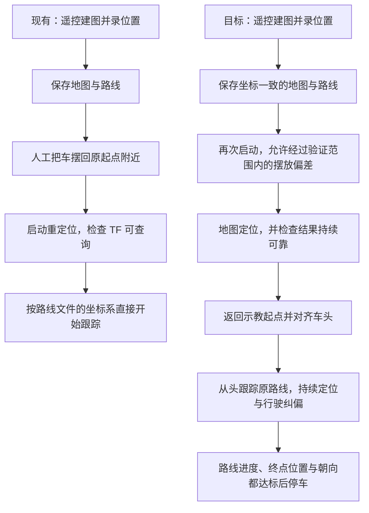

# 从“摆回原位才能走”到“定位后回到起点再走”：路线二与现有方案的区别

本文针对 `car_slam_lap` 里的**实体练习小车**：C8T6 双驱底盘、RDK X5、Odin1 和 DT7 遥控器。这里的练手是用另一台真实小车验证思路，不是在 Gazebo 里运行虚拟机器人。

文章依据当前代码和已有实验记录编写。文中的“现有功能”指代码已经有；“建议修改”指还没有实施；历史实验结果也不代表这次已经重新上车验证。

## 1. 先把上次的“路线二”说准确

你的目标可以用一句话表达：

> 我用遥控器开车建图，保存实际走过的位置。下次车没有摆得完全一样，也能先认出自己在哪，回到原来的起点，然后沿原路线走；途中走偏了，要能修正。

你已经确认：**先回到示教起点，再完整走路线**，不从中途插入。

我上次把应用场景理解成 Gazebo，因此提出了“Gazebo + slam_toolbox 建图 + AMCL 定位 + 返回起点规划 + 原有跟踪器”。这包含了两个层次：

| 层次 | 上次表达的意思 | 对你当前实体车的调整 |
| --- | --- | --- |
| 功能思路 | 识别当前位置 → 返回起点 → 跟踪原路线 | 仍然符合你的目标 |
| 软件选型 | 用 slam_toolbox、AMCL 等组件提供建图定位 | 当前优先继续使用 Odin1 已有的建图和重定位能力，不必因此更换整套软件 |

所以，**功能目标保留，Gazebo 场景下的软件组合撤回。** 下文把适用于这台实体车的调整称为“这次方案”。

## 2. 三种“记住路线”，其实不一样

假设你用遥控器让车向前走，随后左转，再走到桌子旁。

### 第一种：记动作和时间

它记录的是这样的东西：

```text
第 0～5 秒：前进
第 5～7 秒：左转
第 7～12 秒：前进
```

下次按同样的时间发同样的动作。即使轮子打滑、速度变慢，或者初始位置摆偏了，它也可能照旧执行。

这可以类比“蒙住眼睛，照着上次的步数和转身时间再走一次”。没有位置反馈的动作重放，很难保证走在原来的地面位置上。

### 第二种：记位置，运行时追踪这些位置

它保存的是：

```text
A 点：房间里的 (0, 0)
B 点：房间里的 (2, 0)
C 点：房间里的 (2, 1)
```

这里的数字只是举例，单位是米。运行时不断问：“我现在在哪？下一个目标在哪里？该往哪边调整？”

它不要求“第 5 秒一定转弯”，而是到适当的位置再转弯。因此跑得慢一点，主要表现为耗时更长。

**当前代码已经属于第二种。** `record_path.py` 记录位置，`follow_path.py` 用实时位置算速度。文件里虽然有时间 `t`，跟踪器没有按照这些时间重放转弯动作。

### 第三种：让位置记录跨一次启动仍然有效

这才是这次需要重点补齐的部分：

> 同一个目标点，无论这次把车放在哪里开机，都必须指向房间里的同一块地面。

当前不是完全没有纠偏，而是**跨会话的坐标统一、初始定位检查、返回起点流程还不够完整**。

| 对比项           | 按时间重放动作   | 当前实际代码             | 这次方案          |
| ------------- | --------- | ------------------ | ------------- |
| 主要记什么         | 时间与控制动作   | 位置、朝向、时间           | 与保存地图对应的位置和朝向 |
| 运行时看当前位置吗     | 不一定       | 看                  | 看，而且检查定位是否仍可靠 |
| 能修正行驶偏差吗      | 缺少位置反馈时不能 | 有基本的路线跟踪纠偏         | 保留并加强         |
| 能跨启动识别同一地面位置吗 | 没有这个保证    | 现有 `odom` 路线依赖起始对齐 | 通过地图定位和坐标转换实现 |
| 初始摆放偏了怎么办     | 原路线可能整体偏移 | 文档要求人工摆回原位         | 定位后回到起点，再完整执行 |

## 3. 你只需要先理解五个 ROS 概念

### 3.1 节点：各做一件事的小程序

ROS 可以理解成让多个程序相互协作的一套工具。项目里的几个程序分工如下：

| 程序或设备 | 通俗职责 |
| --- | --- |
| Odin1 及其驱动 | 观察环境，提供建图、定位结果 |
| `record_path` | 把走过的位置记下来 |
| `follow_path` | 看当前位置和目标路线，决定前进多快、转多快 |
| `bridge_node` | 把 ROS 的速度消息翻译成底盘串口协议 |
| C8T6 和电机控制器 | 接收命令，让车轮执行 |

遥控建图时，人负责驾驶，记录程序负责记位置；自动走时，跟踪程序接过驾驶任务。

### 3.2 话题：程序之间传消息的频道

例如 `/cmd_vel` 是一个传速度指令的频道，内容大致是：

```text
前进速度：0.10 米/秒
转向速度：0.20 弧度/秒
```

正负号表示方向。“弧度”也是角度单位，一整圈约为 6.28 弧度。初学时先把第二项理解成“往哪边转、转多快”即可。

`follow_path` 把消息发到这里，`bridge_node` 接收并翻译。发出速度命令只是要求车这样动，不等于车已经准确执行，所以仍需要位置反馈。

### 3.3 位姿：位置加朝向

`x、y` 表示平面位置，`yaw` 表示车头朝向。位置正确但车头反着，也不能直接沿路线前进。

### 3.4 坐标系：数字是相对于哪里量的

“前方两米”不够完整。你需要说明，是相对于门口、你自己，还是车刚开机的位置。

| 名称     | 可以怎样理解           | 作用                             |
| ------ | ---------------- | ------------------------------ |
| `map`  | 在房间地面上铺好的一张坐标纸   | 表达原路线在这个环境中的位置                 |
| `odom` | 本次运行使用的局部坐标纸     | 连续描述本次运动，但可能漂移，重启后的原点也不能假设相同   |
| `imu`  | 固定在 Odin1 上的小坐标纸 | 当前项目用它代表设备位姿；安装有偏移时，它不等于车轮转动中心 |

`map` 不是 GPS，也不是地球上的经纬度。它是在这张保存地图里固定下来的参考系。

### 3.5 TF：坐标之间的换算关系

TF 帮程序回答：“这个点在局部坐标里是这个数，换到地图坐标里是多少？”

很多 ROS 教程画 `map → odom → base_link`。本项目用 `imu`，已有资料还记录了 Odin1 把地图关系发布为 `odom → map` 的情况。**实现时应核实实际驱动输出，不要为了让箭头长得像教程，就重复发布一条冲突的 TF。**

对上层程序，关键是能正确查询“设备在 `map` 里的位置”。TF 可以沿关系换算，也可以反向换算。

## 4. 为什么“原点不同”会导致整条路线偏移？

用一个只考虑平移的例子理解：

第一次建图，从门口出发。假设门口是地图 `(0, 0)`，桌子旁是地图 `(2, 0)`。

第二次，你把车放在门口右边 0.5 米处启动。假设这次的局部 `odom` 把这里当成 `(0, 0)`。

```text
房间地图：门口 0 ─── 本次启动点 0.5 ───────── 桌子旁 2

本次 odom：           本次启动点 0 ─────────── 目标应为 1.5
```

如果直接把上次的目标数字 `2` 当作这次 `odom` 的目标，车就会朝房间地图里的 `2.5` 米处走。

但如果地图定位识别出“这次启动点其实在地图的 0.5 米处”，程序就能换算出桌子旁在这次局部坐标下应为 `1.5` 米。

**重定位解决的是“两张坐标纸怎么对齐”，跟踪控制解决的是“车怎么开到正确目标”。** 如果车头也摆偏了，换算还要考虑旋转，TF 会负责这部分计算。

当前 [示例路线文件](/E:/RM/car_slam_lap/demo/venue2/path.yaml) 标明 `frame_id: odom`；[跟踪器](/E:/RM/car_slam_lap/x5/car_bridge/car_bridge/follow_path.py) 会用这个标记决定查哪个坐标系。也就是说，即使另一个脚本已经检查地图定位成功，跟踪器仍可能按 `odom` 追踪。

这正是必须修改的连接处。

**不能直接把文件里的 `odom` 字样改成 `map`。** 数字属于哪个坐标系，需要有证据：验证二者确实重合，或者执行正确的坐标变换；建图优化若改变了历史轨迹，还要处理这些修正。

## 5. 这次方案怎样在实体车上实现？

### 第一步：遥控建图，同时记录“实际走到的位置”

这部分继续复用 Odin1 与 `record_path`。记录的是定位系统估计出的实际位姿，不是“摇杆推了多少”。

例如人把摇杆往前推，但轮子打滑，位置记录应反映实际走了多远；当然，记录精度仍受定位精度限制。

地图和路线要成套保存。地图告诉设备“周围是什么样”，路线告诉跟踪器“这次希望沿哪里走”。只有地图，不会自动知道你示教过哪条路；只有路线，也不能凭空知道当前在房间的哪里。

最终发布给回放使用的路线，要与保存地图处于一致的坐标参考下。记录器默认想用 `map`，但查不到时可能退回 `odom`，因此这里需要明确检查，不能默默退回后当作可跨启动路线使用。

还有一个进阶细节：建图回环可能修正之前的位置估计。实时录好的早期点不会因为写在 YAML 里就自动跟着修正。能取得修正后的历史轨迹时，应据此导出；若设备接口无法提供，要说明限制，必要时在地图稳定后补录路线。这是待验证的实现条件。

### 第二步：再次启动，用旧地图认识当前位置

继续使用 Odin1 的重定位模式，加载建图保存的 `.bin` 地图。

通俗地说，就是把眼前观察到的墙面和物体布局，与旧地图里的结构进行匹配，估计当前位置与朝向。

这不是让程序认为“我一定在上次的零点”。即便初始猜测不完全准确，也要以环境匹配的结果校正。设备具体能容忍多大偏差，要用实车测试确认；配置里的搜索半径不能直接当作保证成功的范围。

### 第三步：确认定位可靠，再回到示教起点

现有脚本主要检查“能不能查到地图 TF”。这次还应检查定位是否持续更新、位姿是否异常跳动，以及设备实际能提供哪些定位状态。

确认之后，目标先设为路线的第一个位姿。到达起点附近，再把车头调整到示教时的方向，然后从第一个点开始执行路线。

这里要把能力边界说清楚：

- **起点附近、小范围偏差、连接路段已确认空旷**：可以设计低速接近起点的控制逻辑，超出范围就停车。
- **从地图里的任意地方返回，中间可能有墙或家具**：需要额外的可通行地图、路径规划和障碍处理，不能只让车朝起点直开。

我上次提到 Nav2，主要是为了第二种返回需求。Nav2 可以承担导航规划，但它不是实现地图定位纠偏的前提。Odin1 的 `.bin` 也不能假定能直接作为 Nav2 的二维障碍地图。

**建议先验收“起点附近摆偏后，定位并回起点”的版本；远距离绕障返回单独扩展。** 这是功能分阶段，不是承诺当前代码已经能返回起点。

### 第四步：沿原路线行驶，并持续纠偏

每次控制循环都重复：

1. 查询车现在在地图里的位置和朝向。
2. 根据已走进度，找当前应该追踪的路段。
3. 在前方选一个合适的目标点。
4. 根据偏差计算前进速度和转向速度。
5. 发出命令，下一次循环重新观察效果。

这叫“闭环”：**观察 → 控制 → 再观察**。当前位置不断参与计算，所以发生小偏差时可以逐渐修正。

现有纯追踪就像骑车时盯着前方一小段路，而不是死盯脚下。它已经能算转向；这次要让它追的是原地图里的正确路线，同时改善急弯切角、交叉路段选错、终点判早等问题。

注意还有两种不同的“修正”：

| 修正 | 修正什么 | 谁负责 |
| --- | --- | --- |
| 定位修正 | 程序对“我在哪里”的估计 | Odin1 定位与坐标变换 |
| 行驶修正 | 车与目标路线之间的实际偏差 | 跟踪器计算速度，底盘执行 |

定位错了，即使跟踪器很努力，也可能追错位置；定位对了但控制不合适，也会走偏。两者都需要验证。

## 6. 用流程图对照现有与目标



其中地图定位和行驶纠偏贯穿运行过程，不是启动时只做一次就结束。

## 7. 对应到代码，哪些保留、哪些修改？

| 文件或模块                | 已有作用                | 建议调整                          |
| -------------------- | ------------------- | ----------------------------- |
| `record_path.py`     | 从 TF 录制 `x、y、yaw、t` | 明确路线坐标和所用地图；防止不合格路线进入跨会话回放    |
| `path_io.py`         | 读写路线文件              | 补充地图标识、车体参考等信息及校验，具体格式实施前约定   |
| `start_relocal.sh`   | 配置 Odin1，加载地图并等待 TF | 检查有效配置与定位更新，不把可查询 TF 当作唯一成功条件 |
| `follow_path.py`     | 根据实时位姿纯追踪路线         | 使用正确地图参考；加强进度约束、急弯与终点判定       |
| 新增的任务流程逻辑            | 当前缺少                | 管理等待定位、回起点、对齐、跟踪、完成和故障状态      |
| `bridge_node.py` 与固件 | 速度翻译、状态反馈、底盘执行      | 第一阶段优先复用；核对遥控示教与自动控制权交接       |

“状态”可以理解成程序当前正在办哪件事。例如回起点没有完成，就不能跳到“跟踪原路线”；定位丢了，就进入停车等待，而不是继续执行旧速度。

下面四项是把这篇解释变成可实施方案时需要明确的约定。

### 【输入输出定义】

- 输入：同一场地的地图、有序示教路线、当前定位、底盘状态。
- 路线至少表达：参考坐标系、位置、朝向、先后顺序。时间保留作记录，第一版不复现示教时的停留时长。
- 输出：实时速度指令、任务状态、实际轨迹和结束原因。
- 起步规则：先定位，再回到第一个位姿并对齐，最后从头走；不能用就近路点接入代替。

### 【核心算法逻辑伪代码】

```text
读取地图和路线，确认它们对应同一套坐标
等待地图定位有效且持续更新

如果当前位置不在已验收的起点接近范围内：
    停车，提示需要人工放近，或使用后续的路径规划功能

低速回到路线起点，调整车头方向
将路线进度设为开始

反复执行：
    检查定位、底盘状态、急停和前方通行条件
    条件不满足就停车，记录原因
    读取地图里的当前位置
    在当前路线进度附近找目标，避免跳到其他路段
    根据位置与方向偏差计算速度
    发命令并保存实际结果
    整段已执行，且终点位置与朝向达标时，停车并报告完成
```

### 【异常与边界条件】

- **定位不能确认**：停车；不能靠“先随便走起来”保证能恢复。
- **定位结果停更**：旧 TF 可能仍可查询，需要识别数据是否新鲜。
- **地图或路线不匹配**：拒绝自动走，不能修改标签后强行使用。
- **路线折返或交叉**：按顺序和行驶方向约束匹配，防止跳过一段。
- **路线有障碍**：已有跟踪器没有完整绕障能力。第一版需限定空旷测试环境，障碍检测与停车条件要明确；自动绕障另做功能。
- **人工接管或急停**：控制权切换明确，不能让遥控和自主程序同时争着开车。
- **路线中含倒车、原地转向或停留任务**：需显式描述这些动作；只保存位置并向前追踪，不能保证复现它们。

### 【验收测试用例】

先用慢速、短路线区分每个环节是否有效。下面是测试设计，不是已通过的结果，也不是保证设备一定能容忍这些偏差。

| 测试     | 怎样做                                   | 要验证的现象                |
| ------ | ------------------------------------- | --------------------- |
| 基础回放   | 接近原位启动                                | 完整执行路线，形成误差基线         |
| 摆放偏移   | 在确认空旷的起点附近，从小偏移逐步增加，例如先 10 cm，再 20 cm | 正确估计地图位置，先回起点，再走原路线   |
| 朝向偏移   | 起点附近将车头偏转小角度，例如先 5°，再 10°             | 起步方向经过对齐，路线不随初始车头一起旋转 |
| 定位初猜不准 | 在设备支持的接口中给出受控的小误差                     | 能识别未收敛状态；只有定位可靠才进入行驶  |
| 速度变化   | 用两个已标定的低速回放同一条路线                      | 耗时变化，但目标仍是同一条空间路线     |
| 定位故障   | 用可控方式模拟数据停更                           | 停车并给出定位原因，不继续追逐旧位姿    |
| 终点检查   | 走完后测量最终位置和车头                          | 不能只因进度索引到末尾就报告成功      |

实车上要用地面标记或独立测量核对位置。仅看跟踪器自己打印的误差不够，因为它也依赖同一套定位，定位整体偏了时，自报误差仍可能很好看。

## 8. 看懂后，你应该能回答这五个问题

1. **“位置”从哪里来？** 来自 Odin1 的定位估计，经驱动与 TF 提供给记录和跟踪程序，不是来自遥控器摇杆位置。
2. **车摆偏了，为什么原路线还能不变？** 原路线绑定保存地图；地图定位识别本次实际位置，TF 负责坐标换算。
3. **地图是不是路线？** 不是。地图描述环境，路线描述你希望经过哪些位置。
4. **纠偏是不是已经有了？** 有基本跟踪纠偏；这次重点补跨会话坐标一致、定位检查与先回起点，并改善跟踪边界。
5. **是不是必须学完 Nav2 才能做？** 不需要。先理解并复用现有 Odin1 定位和跟踪链路；需要远距离绕障返回时，再引入规划能力。

## 9. 对照阅读入口

建议按顺序看；第一次不必读懂全部 Python 语法，先找输入、处理和输出：

1. [项目 README](/E:/RM/car_slam_lap/README.md)：确认练习车硬件、建图与走圈入口。部分章节是较早状态，应结合代码和后续实验记录阅读。
2. [示教路线示例](/E:/RM/car_slam_lap/demo/venue2/path.yaml)：看 `frame_id`，再看每个点的 `x、y、yaw、t`。
3. [记录程序](/E:/RM/car_slam_lap/x5/car_bridge/car_bridge/record_path.py)：重点看 `_lookup`、`_on_odom` 和 `save`，分别对应取位姿、挑选记录点、存文件。
4. [重定位脚本](/E:/RM/car_slam_lap/x5/scripts/start_relocal.sh)：看加载哪张地图，以及怎样判断启动成功。
5. [跟踪程序](/E:/RM/car_slam_lap/x5/car_bridge/car_bridge/follow_path.py)：重点看 `_pose`、`_nearest`、`_target`、`_tick`，分别对应当前位置、匹配路线、前方目标、控制循环。
6. [已有实车记录](/E:/RM/docs/issues/2026-10-26-odin-config-and-follow-path.md)：区分“已经跑通”和“精度已经达标”；该记录仍有掉头切角与终点误差待改进。

下一步的工程起点应是验证：**Odin1 重定位后的地图位姿，与这次保存路线的参考是否一致。** 先把这一处查清，再实现“先回起点”，最后调跟踪效果，才能知道每一处改动究竟解决了什么问题。
