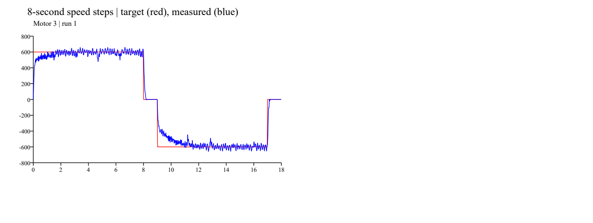

# Ki=0.004：3号完整18秒补测

2026-10-29，在上一轮3号末尾零速不完整后，保持固件参数不变单独补测。此次完整记录正转、零速、反转、最终零速及退出后零电流，补齐3号本轮功能序列的证据；未将两轮片段拼接成一次测试，也不据此宣称速度环定量整定完成。

## 条件与完整性

- 模式3、Kp=2、Ki=0.004/2ms、积分限幅400、指令限幅±1500、目标±600转子rpm，8/1/8/1秒时序。
- 沿用当前已烧写固件，本轮没有修改或重新烧写参数；采集器仅接收CAN。
- 接收窗口119.958秒，共551270帧、4614条0x1F2。原始帧保留于本地 `_probe/can_capture_ki004_motor3/capture.csv`。
- 设备相对24.254～42.267秒仅3号进入运行，观测总时长18.013秒；四阶段约8.005/1.014/7.980/1.014秒，符合诊断采样下8/1/8/1秒时序。
- 整段没有反馈不可用/超速取消诊断；所有原始0x200指令均未命中±1500限幅，峰值1210。其他三轮指令始终为零，3号退出后全部原始电流指令保持零。
- 活动段指令最长间隔2.389ms，3号反馈最长间隔1.664ms，均无超过4ms的空档。全记录在测试开始前约18.665秒存在约31ms共同时序间隙，原因未确认，不与活动段混为一谈。
- 全记录4号曾于测试开始前约15.851秒反馈648rpm，但4号原始指令始终为零，原因未确认；3号活动期间其他轮反馈绝对值最多7rpm。此活动窗外记录不用于3号速度比较。

## 速度与零速

| 指标 | 正转 | 反转 |
| :--- | ---: | ---: |
| 目标rpm | 600 | -600 |
| 最后2秒平均rpm（诊断反馈） | 593.82 | -598.83 |
| 平均误差绝对值 | 1.03% | 0.19% |
| 最后2秒标准差rpm | 31.56 | 27.85 |
| 阶段结束前2.2～0.2秒原始反馈均值rpm | 595.94 | -597.48 |

- 两段零速最后0.5秒反馈绝对值分别≤3rpm、0rpm；最终零速后退出并释放输出。
- 3号原始转速绝对值峰值669rpm，温度22℃；没有进行超速或掉线的故障注入。
- 本次仍未找到“进入±5%后至少1秒且保持到段末”的瞬时速度调节时间，纹波尚在。
- 上一轮Ki=0.004的3号后2秒均值为595.96/−603.47rpm，本次为593.82/−598.83rpm。单次波动与窗口差异存在，不能把之前0.10%～0.69%的范围作为所有复测都满足的保证。
- 相比Ki=0.002基线（593.52/−581.62rpm），本次反向末段欠速仍明显减小；正向末段均值并非每次都进一步改善。其他方向和电机的比较仍以各自独立记录为准。

## 结果与下一步

结合上一轮正常1/2/4号完整序列，四轮在Ki=0.004下均有完整单轮运行、零速和退出记录。它们分属不同采集窗口，不能称为一次连续四轮重复验收；也不证明更换后CAN接线长期可靠。

保持Ki=0.004，不继续加增益或放宽限流。下一步在固定可靠接线条件下，围绕约70Hz角度相关纹波与2/4号低频降速设计单变量实验；动态响应和瞬时波动验收前暂不直接落地联动。

分析与校验均通过：[analyze.py](analyze.py)、[check_capture.py](check_capture.py)、[summary.json](summary.json)、[quality.json](quality.json)、[telemetry.csv](telemetry.csv)。
