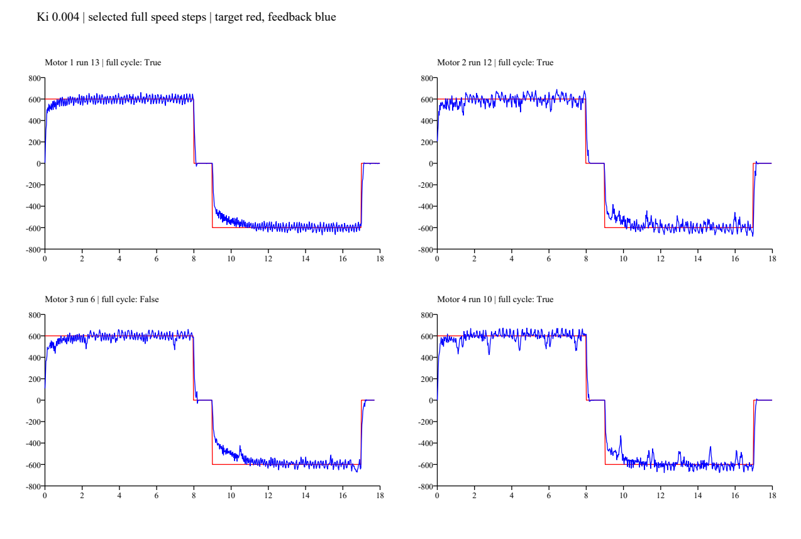

# Ki=0.004首轮对照：收敛加快，CAN线故障片段单独保留

2026-10-29，用户确认烧写本轮对照固件，并报告2号初始因接触不良不动，更换CAN通信线后恢复，随后完成四轮测试。换线时刻未精确标记，因此不能将2号前后差异全部归因于Ki。

结论：正常速度段显示积分换向与平均跟踪改善，支持暂时保留Ki=0.004继续验证；纹波和2/4号间歇下降仍存在，不继续加大Ki或放宽限流。采集未覆盖3号完整的最终零速段，整轮生命周期还需补测。没有因选取正常片段而删除或隐藏异常记录。

## 条件与原始记录

- 固件准备提交 `5434b72`，用户确认已烧写。模式3、±600转子rpm、8秒正转/1秒零速/8秒反转/1秒零速。
- Kp=2、Ki=0.004/2ms、D=0、积分限幅400、指令限幅±1500，无滤波。唯一计划内参数变化为Ki=0.002→0.004；2号另有CAN线更换这一非计划硬件变化。
- 接收接口、通道和波特率沿用前轮配置；本次仅接收，没有由采集器发送电机控制帧。
- 共1366467帧、11507条0x1F2诊断，窗口约300秒，原始帧保存在本地 `_probe/can_capture_ki004/capture.csv`，未覆盖基线。
- [分析脚本](analyze.py)、[全尝试及比较统计](summary.json)、[完整诊断导出](telemetry.csv)。
- [原始轮速、电流、积分与频谱统计](dynamics-summary.json)，由[动态分析入口](analyze_dynamics.py)复用前轮同一分析方法生成。

## 完整性与选择规则

13次尝试全部保存于summary的all_runs。对每个电机先选最后一次完整8/1/8/1秒且没有故障结束的测试；若没有整轮完整样本，只在完整正反速度段存在时进行受限比较，并明确标注最终零速不完整。未将短速度段、限流段或故障段补接成完整测试。

| 选入测试 | 设备相对起点 | 完整性 | 原始指令峰值 | 指令最长间隔 | 本轮反馈最长间隔 |
| :--- | ---: | :--- | ---: | ---: | ---: |
| 1号，第13次 | 262.090s | 整轮完整 | 1199 | 2.389ms | 1.493ms |
| 2号，第12次 | 232.019s | 整轮完整；处于最后一次故障之后 | 1077 | 2.390ms | 1.494ms |
| 3号，第6次 | 88.338s | 正反速度段完整，末尾零速仅约0.72s | 1004 | 2.389ms | 1.622ms |
| 4号，第10次 | 173.508s | 整轮完整 | 1204 | 2.389ms | 1.749ms |

3号另一次约165.24秒开始的测试只有约2.1秒正转，不能替代完整测试。采集中没有其余整轮完整3号记录；用户可能在窗口外又完成测试，但本采集无法据此补齐数据。

## Ki对照结果

以下都是每段最后2秒的0x1F2反馈窗口均值，目标±600rpm。1号以基线的最后一次补测对照，其他轮以基线各自测试对照。2号有换线因素，3号仅速度段比较，单次试验不足以给出总体统计显著性。

| 电机 | 基线正转均值 | 本轮正转均值 | 基线反转均值 | 本轮反转均值 | 本轮正/反平均误差 |
| :--- | ---: | ---: | ---: | ---: | ---: |
| 1号 | 596.84 | 600.90 | -596.25 | -599.14 | 0.15% / 0.14% |
| 2号 | 595.68 | 601.55 | -593.66 | -599.40 | 0.26% / 0.10% |
| 3号 | 593.52 | 595.96 | -581.62 | -603.47 | 0.67% / 0.58% |
| 4号 | 588.70 | 600.83 | -597.87 | -604.13 | 0.14% / 0.69% |

反转积分首次换为反向的时间（由未饱和诊断样本中u−Kp·误差反算）：

| 电机 | Ki=0.002基线 | Ki=0.004本轮 |
| :--- | ---: | ---: |
| 1号 | 1.092s | 0.416s |
| 2号 | 1.170s | 0.442s |
| 3号 | 1.196s | 0.546s |
| 4号 | 1.092s | 0.494s |

平均收敛确实更快。例如1号反转第2秒的均值由约−512升至−560rpm，第3秒由约−545升至−590rpm；3号反向末段平均欠速也减小。上述换向时间是积分项换向，不代表电机直到此时才反转。

## 波动没有随平均误差一起消失

- 本轮后2秒速度标准差约27～45rpm，基线约27～49rpm；各轮变化不一致。2号正转从39.40增至45.37rpm，4号正转从48.85降至44.96rpm，不能笼统称为波动已改善。
- 1号第7阶角度相关纹波幅值从约34rpm变为约35.5～36.2rpm，仍然存在；单次差值不证明Ki导致纹波增大。
- 按原始数据统一检测“首秒以后低于目标方向500rpm”的降速分组，2号正/反约10/10组、4号约7/6组，低频下降仍在。该阈值统计受瞬时纹波、趋势及分组间隔影响，不是硬件故障计数。
- 选入速度段原始峰值绝对转速依次670/705/697/703rpm，反馈温度依次21/21/22/22℃；没有达到1500rpm超速阈值。不因此宣称动态超调或故障保护已完成验收。

## 异常必须与正常对照分开

- 全记录确实有7576帧原始指令命中1500限幅：均在2号第8次（3642帧）和第11次（3934帧）尝试，未混入上述正常对照。500Hz指令下合计约15秒的采样帧数，不等于连续15秒事件。
- 2号原始反馈最长空档约10.399秒，发生在设备相对213.189～223.588秒；第11次尝试末尾出现明确的状态2“反馈不可用”取消。反馈恢复后没有自动续跑，后续重新选轮才启动。
- 约228.36秒附近其他电机反馈也有约0.13秒共同空档，整个记录的指令最大间隔约0.578秒。不能把整段采集描述成“CAN始终连续”；共同时序空档的具体原因未确认。
- 最后选入的正常段均没有限流，指令与对应轮反馈最长间隔如上表。后续2号完整测试恢复正常，只支持该次测试，不证明接线长期可靠。
- 已确认更换的是2号CAN通信线，不能将2号不动直接当作PI参数问题；也不能将本次异常反推为上一轮所有速度下降都由CAN线造成。

## 下一步

后续已完成独立的[3号完整补测](../2026-10-29-single-wheel-ki004-motor3/README.md)，补齐末尾零速与释放；下列为本轮分析时提出的接续步骤，补采3号这一项已完成。本报告原始数据及完整性结论保持不变。

1. 保持Ki=0.004及当前其他参数，不再叠加增益、滤波或放宽限流。
2. 先确认更换后的CAN连接固定可靠；准备好后，仅补采3号一轮，让最后1秒零速自然结束，再确认释放。若用户希望四轮最终验收，再在相同接线条件下完整重复四轮。
3. 单轮尚未验收通过，保留原始纹波、低频降速及接线可靠性的待办；下一步再设计滤波/机械检查，暂不直接下地联动。
