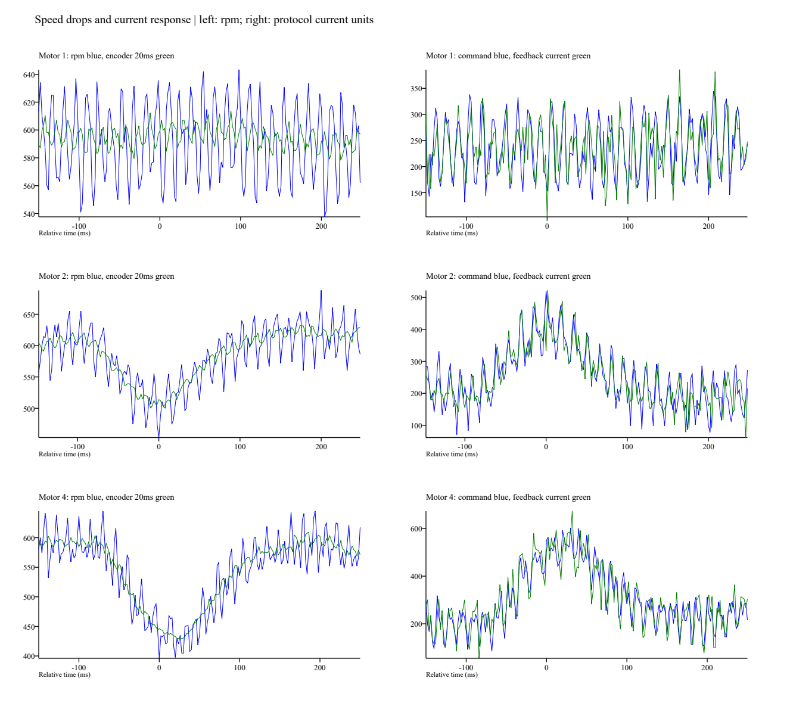

# 轮速、电流与积分关联分析；下一轮仅对照Ki

## 结论和边界

现有采集支持将问题分成三部分：随转子角度变化的高频纹波、2/4号额外的低频降速、以及较慢的积分建立。CAN发送/接收间隔连续，未发现指令触及限幅，也未发现同时给多轮非零指令。不能把这些结果扩大为机械和电调已无问题。

准备Ki=0.004的单变量对照版本，检验积分建立和反向收敛是否加快；这是实验假设，不是已验证的修复。其他参数与时序保持基线值，尚待用户烧写并架空复测。

分析源码：[analyze_dynamics.py](analyze_dynamics.py)；逐段结果：[dynamics-summary.json](dynamics-summary.json)。输入为本地原始 `capture.csv`，脚本不接触硬件。使用设备时间戳、原始反馈约1kHz和电流指令约500Hz；阶段首秒不纳入事件检测，末尾留0.2秒裕量，频率/相位分析窗口为阶段末前2.2～0.2秒。

## 1. 发送和反馈连续，电流有补偿

- 0x200指令间隔中位数2.005ms、99分位2.261ms、最大2.432ms；没有超过4ms的间隔。
- 四轮反馈最大间隔分别1.536/1.664/1.749/1.792ms。这里衡量的是采集端收到的帧间隔，不是MCU内部精确调度周期或完整性证明。
- 全部0x200指令绝对值峰值为1202，未触及1500；同一帧最多只有一个电机的指令非零。
- **纠正采样口径**：此前报告的1120是0x1F2低频诊断峰值，1202是本次从0x200原始指令取得的峰值。两者不冲突，后者更完整。
- 2号正转约6.962秒处降至453rpm，之后20ms指令均值由此前约240升至415，电流反馈由248升至402；首次回到570rpm约44ms。
- 4号正转约3.208秒处降至396rpm，之后20ms指令均值由此前约221升至514，电流反馈由235升至509；首次回到570rpm约90ms。
- 上述“首次回到570”不是持续保持在误差带内的调节时间；20ms统计与2ms网格不能证明精确的控制响应延迟。
- 编码器角度以0..8191编码，模8192展开后，用20ms中心差分得到的速度与同等20ms平均的rpm反馈相关系数0.930～0.994，RMSE约4.7～7.6rpm。2/4号慢降速在角度变化中同样可见。两者来自同一电调/编码器，不能当作独立测速仪验证，也不能将被20ms平滑减小的高频成分直接认定为噪声。

## 2. 1号纹波与转子每转7次的相位成分相关

- 1号两次正转主频均约70Hz，反转约69～69.5Hz；晚段转子转频约9.9Hz。
- 用转子角度的第7阶正余弦回归，1号四段幅值约33.9～34.5rpm，可解释去线性趋势后约81%的速度方差；第1～6阶各自解释比例不足1%。
- 频率随转速变化：例如1号首次反转，第2秒均速绝对值约505rpm时高频峰约59Hz，第7秒约593rpm时高频峰约69Hz。它不是整个过程固定70Hz的振荡。
- 这支持“与每转7次的角度相关纹波”的描述；尚不能单凭频谱确定为电机换相、编码器非线性、机械齿槽或外环自激中的哪一种。不要把“7阶”未经硬件核实直接写成电机极对数。
- 2/4号晚段最大谱峰分别约4/3.5Hz，第7阶只解释约16%～30%的方差，另有较慢的降速过程。直接给所有轮子加同一种滤波，不能证明这些低频问题会改善。
- 原0x1F2约38.5Hz采样的奈奎斯特频率约19.2Hz，不能靠该曲线辨认约70Hz纹波；该部分频谱必须从原始反馈计算。

## 3. 反转继承正向积分，积分建立确实较慢

在未饱和段，由 `u=2*(目标-反馈)+I` 反算积分；整数截断使单点约有1个指令单位的不确定性，不影响下列量级结论。

| 测试 | 反转开始的积分估计 | 积分首次变为反向所需时间 | 全段积分绝对值峰值 |
| :--- | ---: | ---: | ---: |
| 1号首次 | +193 | 1.118s | 224 |
| 2号 | +172 | 1.170s | 216 |
| 3号 | +270 | 1.196s | 334 |
| 4号 | +193 | 1.092s | 225 |
| 1号补测 | +184 | 1.092s | 218 |

- 零速段没有复位积分，正转结束的正向积分在制动后仍保留，因此反转首先消除正向积分，再建立反向出力。这是测试序列历史的影响，不能把正反前两秒的差异全归因于硬件方向差异。
- 3号反转每秒积分均值约+141、−39、−144、−212、−259、−289、−313、−327，未触及±400积分限幅；末段仍在建立出力。当前没有放宽积分限幅或电流上限的依据。
- 该证据支持检验更快积分的假设，但不证明提高Ki能修复2/4号低频降速或第7阶纹波；也不保证增益提高后的稳定性。

## 4. 下一轮对照实验

唯一固件参数变化：Ki由0.002/2ms增至0.004/2ms。Kp=2、D=0、原始rpm反馈、积分限幅400、指令限幅±1500、目标±600rpm、8/1/8/1秒全部保持基线。

不同时引入滤波、积分换向复位或各轮独立增益，确保能够解释两轮差异。模式3的KEY取消、反馈失联和超速取消逻辑不变。

重新烧写后仍按1→2→3→4→1完整测试，采集先启动，保持架空无接触。将下列指标与本次0.002基线并排比较：

1. 每秒速度均值、最后2秒平均误差、反转积分过零时间，检查是否加快收敛。
2. 原始反馈的第7阶纹波幅值、低频降速深度与恢复过程，检查是否恶化波动；0.25秒均值只用来辅助观察慢收敛，同时保留原始瞬时指标。
3. 指令及反馈电流峰值、限幅、故障标记、温度和重复性；若异常加剧，回退Ki=0.002，不能因平均误差变小就判为通过。

Ki=0.004主机速度逻辑测试通过，Keil AC5实编译0错误0警告，Code=64924；尚未烧写或采集本轮Ki对照数据。
