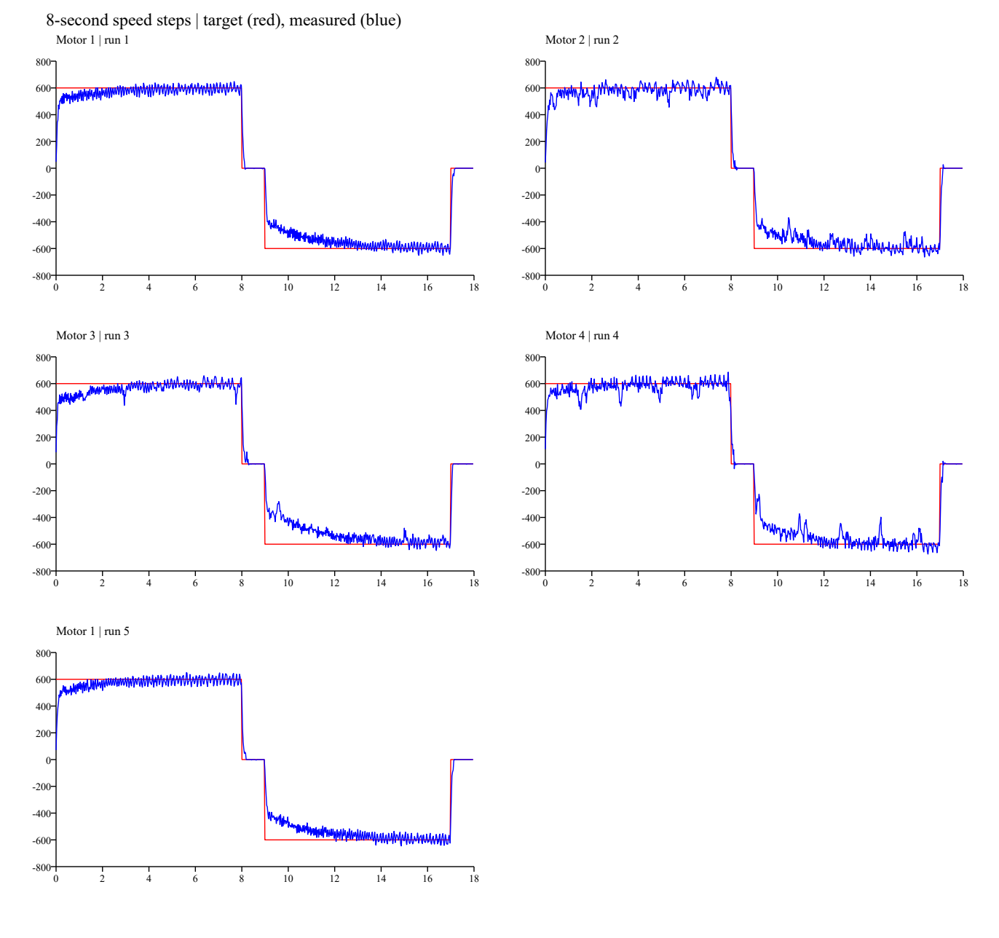

# 单轮速度闭环：正反各8秒的架空采集

2026-10-29，用户确认已烧写并完成测试，全程架空、无接触。结论：延长窗口后平均欠速明显收敛，但瞬时波动仍在，尚不能判定单轮定量整定完成。本轮只接收CAN，未调整固件参数。

## 条件与完整性

- C板、M3508/C620，CAN通道和参数沿用前两次已验证的PCAN-Basic接收配置（0x51、0x14）。
- 固件时长变更提交：`a66ab11`。模式3，目标±600电机转子rpm，正反各8秒、两段零速各1秒；Kp=2、Ki=0.002/2ms、积分限幅400、电流指令限幅±1500。
- 设备时间覆盖299.969秒，1378646帧，11539条0x1F2遥测。
- 完整顺序1→2→3→4→1；额外1号完整保留，未覆盖或混合平均。
- 所有正反段观测长度8.005～8.010秒，零速段约0.988秒；边界受诊断采样量化影响，符合8/1/8/1时序。
- 遥测间隔中位数25.984ms、最大26.282ms；原始四轮反馈约1001～1004Hz。
- 原始帧保留于本地 `_probe/can_capture_long8s/capture.csv`，未覆盖两次旧采集；分析脚本同目录 `analyze.py`。
- 解码数据：[telemetry.csv](telemetry.csv)，全部统计：[summary.json](summary.json)。

## 平均跟踪：各恒速段最后2秒

以下是0x1F2反馈的窗口统计，正向目标+600、反向目标−600；不是宣称最终稳态误差。误差百分比=平均反馈与目标之差的绝对值/600。

| 测试 | 正转均值 rpm | 正转误差 | 反转均值 rpm | 反转误差 | 正/反标准差 rpm |
| :--- | ---: | ---: | ---: | ---: | ---: |
| 1号首测 | 594.92 | 0.85% | -594.12 | 0.98% | 27.71 / 27.13 |
| 2号 | 595.68 | 0.72% | -593.66 | 1.06% | 39.40 / 39.44 |
| 3号 | 593.52 | 1.08% | -581.62 | 3.06% | 35.05 / 32.07 |
| 4号 | 588.70 | 1.88% | -597.87 | 0.35% | 48.85 / 39.59 |
| 1号补测 | 596.84 | 0.53% | -596.25 | 0.63% | 28.65 / 26.83 |

- 1号两次重复性较好；3号反向残余平均欠速最大。
- 各恒速段第一秒均值正向约471～514rpm，反向绝对值约356～434rpm，之后逐步接近600。此前2秒末段的6.9%～16.3%欠速不能直接当作最终稳态误差；本轮窗口提供了继续收敛的证据。
- 前轮与后轮、各方向的误差并不相同；当前单次样本不足以归因于特定机械问题或某个PI参数。

## 波动与原始反馈交叉核对

- 所有10个非零段均未出现“进入±5%后保持至段末且至少持续1秒”的诊断采样区间。因此不能用平均误差小来宣称瞬时速度已稳定在±5%以内。
- 4号正转后2秒诊断样本范围424～686rpm，标准差48.85rpm；2、4号有间歇下降，1号可见较规则的速度纹波。
- 另用约1kHz的0x201～0x204交叉核对：为避开诊断阶段边界约26ms的定位不确定性，统计阶段结束前2.2～0.2秒，不将切零后的制动样本混入恒速波动。
- 该原始反馈窗口中，4号正转426～696rpm、标准差44.77rpm，2号正转449～692rpm；说明波动也存在于原始电机反馈中。不能据此分辨真实机械速度纹波、测量纹波与控制振荡各占多少，滤波和调参仍需分别验证。
- 用户明确确认全程架空、无接触；不能将本轮4号降速直接归入首轮的人为施力原因。

## 电流、零速与保护

- 全部诊断样本电流指令峰值绝对值1120，未采样到±1500限幅。没有支持直接提高限流的证据。
- 3号恒速后2秒电流指令均值约+315/−357，其他轮绝对值约216～232；存在出力需求差异，但电流指令单位不是安培。
- 所有零速段最后0.5秒反馈绝对值≤5rpm；零目标阶段PI仍有保持电流，不等同于释放。18秒结束后才退出测试。
- 未见状态2/3的掉线/超速取消遥测。原始反馈峰值绝对值分别663/692/665/696rpm，温度21～22℃。这不是故障保护专项验证。

## 下一步

1. 保留此8秒原始参数基线，不增加电流上限。
2. 先对2、4号间歇下降与1号规则纹波做原始反馈/电流的时间关联分析，核对机械周期性阻力与测速纹波；3号单独关注反向收敛和出力差异。
3. 若进行固件整定，每次只改一个参数，沿用8秒时序复测。滤波会增加延迟，应与原始反馈并行比较后再采用；不能以曲线变平滑作为唯一验收。
4. 单轮动态响应与波动验收后，再进入四轮架空联动和落地测试。
