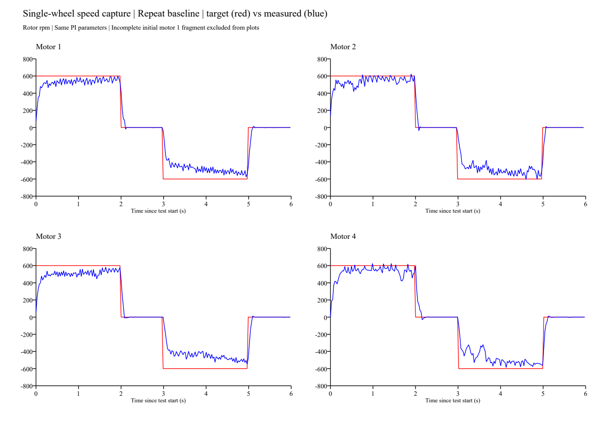

# 四轮无外部接触复测：欠速可复现，4号未重现近乎停转

## 条件与数据完整性

- 日期：2026-10-29；接续上一轮，保持架空，要求用户不接触轮子，依次按KEY触发；未额外测量外载。
- 沿用模式3和本地源码参数：电机转子目标±600 rpm、Kp=2、Ki=0.002/2ms、积分限幅400、输出指令限幅±1500。
  本次未修改/烧写固件，未读取板内代码校验值。
- PCAN-Basic接收、同一USB通道和已有BTR=0x0014；不调用发送控制帧接口。
- 89.994秒，共413604帧。0x1F2共3462帧，四个C620各90085～90338帧，约1001～1004 Hz。
  频率由设备时间戳和帧数估计，不是精确标定的采样时钟频率。
- 启动时1号已进入最后零速段，开头0.598秒片段**不用于完整测试统计或曲线**。
  按提示补测1号，最终完整顺序为2→3→4→1，四轮各有一套正/零/反/零序列。
- `telemetry.csv`保留全部3462条遥测，`summary.json`明确记录排除片段与完整测试。

## 结果与上一轮对比

以下是各非零目标段最后0.5秒的平均转子rpm，不代表已达到稳态。

| 电机/轮位 | 上轮正转 | 本轮正转 | 上轮反转 | 本轮反转 |
| :--- | ---: | ---: | ---: | ---: |
| 1 右前 | 554.8 | 558.6 | -525.2 | -527.1 |
| 2 左前 | 566.0 | 556.0 | -505.1 | -520.5 |
| 3 左后 | 526.9 | 543.1 | -495.1 | -502.4 |
| 4 右后 | 198.9（外力干扰） | 521.8 | -481.1 | -540.1 |

- 正转末段平均欠速6.9%～13.0%，反转欠速10.0%～16.3%，重复出现，第一阶段仍未完成定量验收。
- 本轮4号未出现上轮正转近乎停转的波形；上轮用户确认曾接触/施加阻力，该轮两次数据不作严格同载比较。
- 零速段最后0.5秒，四轮采样转速绝对值均≤3 rpm。
- 已采样电流指令均未达到±1500；遥测采样峰值最大为1202。不能排除遥测间隔内短暂限幅。
- 0x1F2未见反馈不可用或超速取消标记；不是故障停机专项测试。四轮均自然结束，未重新验证KEY取消。
- 直接C620反馈记录的最大转速绝对值分别613、644、600、634 rpm；温度为21～22℃。

## 可支持与不可支持的判断

1. 可支持：四个电机均有完整正反转及零速阶段，实际速度随目标方向变化，基本闭环工作。
2. 可支持：短暂两秒恒速段末尾仍欠速且存在波动，“看起来平稳”不足以宣称转速准确。
3. 不可支持：两秒内尚未充分收敛，不能把末0.5秒平均误差称为最终稳态误差，也不能据此直接指定新PID参数。
4. 不可支持：数据不足以断言轮子或电调损坏；4号本轮波形没有重现上轮受扰停转。
5. 若按源码PI关系估算积分项 `I≈输出指令−2×(目标−实际)`，四轮非零目标段末尾均未贴住±400。
   该估算依赖板上参数与源码一致，存在输出整数截断；只能作为线索，不能替代板内变量读取。

## 下一步

先保持现有电流上限与故障保护，延长正反恒速观察窗口，判断误差是否继续收敛；
再结合曲线逐项调整PI，必要时评估反馈滤波。当前不建议为弥补欠速直接放宽电流限幅，
也不把这组参数直接用于落地四轮联动。运行时不通过手抓轮子制造负载。

本次只采集、分析与记录，未改变固件、测试时序或参数。

## 文件

- `telemetry.csv`：全部0x1F2解码，设备相对时间，转子rpm与电流指令原始协议单位。
- `summary.json`：完整四轮逐段统计，开头不完整片段说明。
- 完整原始帧本地保留在 `_probe/can_capture_run2/capture.csv`，不入Git；上一轮原始帧未覆盖。
- [上一轮报告](../2026-10-29-single-wheel/README.md)。

