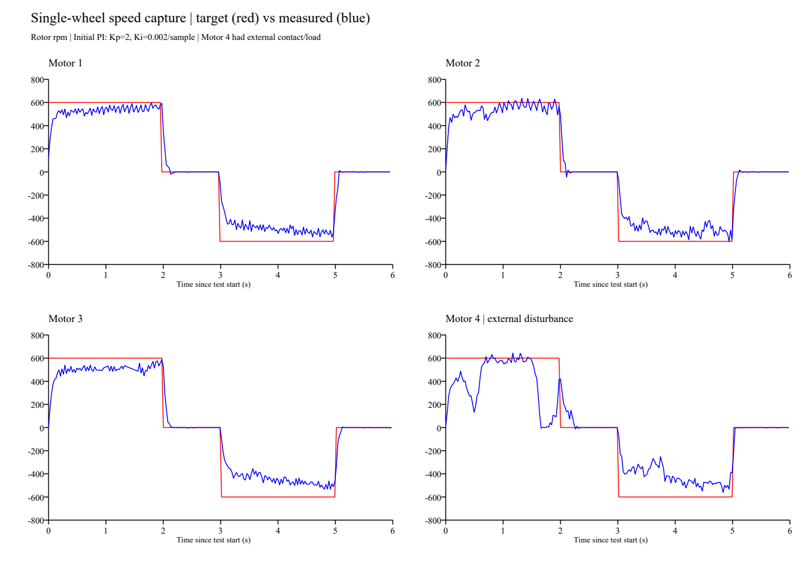

# 四轮单轮速度闭环：功能已通，速度跟踪仍需整定

## 环境与采集

- 日期：2026-10-29；C 板、四轮全向底盘、C620；用户此前确认四轮架空，正反转及 KEY 取消均正常。
- 代码基线：`d2dd04f`，模式3，目标为电机转子 ±600 rpm；Kp=2、Ki=0.002/2ms、积分限幅400、电流指令限幅±1500。
  参数来自本地源码及帧内容，未读取板内固件校验值。
- PCAN-Basic DLL 4.6.2.753；USB通道0x51，读取当前 BTR=0x0014（经典CAN 1M），按已有连接参数接入。
- 仅调用读取接口，不发送 CAN 控制帧，不重设底盘参数；采集结束释放本进程通道。
- 时长89.991秒，共410146帧；四个C620各89331～89580帧，约993～995 Hz。
- `0x1F2` 3431帧，约38.1 Hz；实际发送受2ms任务调度影响，不能把文档名义25ms当作精确40Hz。
- 实际测试顺序：1→2→4→3，每轮一次完整正/零/反/零序列。受扰信息：用户确认4号轮测试时曾接触或施加阻力。

## 结果

以下为各非零目标段**最后0.5秒**的反馈平均值，不代表已达到稳态；目标分别为+600与−600转子rpm。

| CAN ID / 轮位 | 正转末段均值rpm | 反转末段均值rpm | 说明 |
| :--- | ---: | ---: | :--- |
| 1 右前 | 554.8 | -525.2 | 均低于目标幅值 |
| 2 左前 | 566.0 | -505.1 | 有可见速度波动 |
| 3 左后 | 526.9 | -495.1 | 均低于目标幅值 |
| 4 右后 | 198.9 | -481.1 | 正转受外力，不能据此比较空载性能 |

- 1/2/3号轮正转末段平均欠速5.7%～12.2%，反转欠速12.5%～17.5%。需继续整定，不能判为第一阶段定量验收完成。
- 各零速段最后0.5秒的已采样反馈绝对值均不超过3 rpm，低速停稳表现良好。
- 四轮直接C620反馈的最大转速绝对值分别为623、650、608、661 rpm；反馈温度全程21℃。
- `0x1F2` 未记录到状态2（反馈不可用）或3（超速取消）。这是本次记录观察，不等同于故障停机测试通过。
- 1/2/3号轮的遥测采样点未达到±1500指令上限；4号正转约1.3%的遥测采样点达到上限。
  不能据此排除25ms采样间隔之间的短暂限幅。
- 本次四轮均自然结束，未单独采集KEY取消；取消功能依据此前用户反馈，未作为本次仪器验证结果。

## 解读与下一步

已有结果支持“方向与基本反馈闭环工作”，但2秒速度段内仍有欠速和波动。
不能仅凭本次数据把原因归为积分过小：积分限幅、摩擦/载荷、初始参数与反馈噪声均可能相关。
4号外力作用时间与大小未知，只能标注为受扰，不能计算恢复时间或比较严格的抗扰指标。

下一步先为四轮各录一次**无外部接触**基线；必要时延长恒速段观察收敛，再逐项整定PI。
保留限流与故障取消，不同时大幅更改多个参数；不要通过手抓旋转轮子制造负载。
完成单轮定量验收后，再进入四轮解算与落地运动测试。本次未修改固件或PID参数。

## 数据与图

- `telemetry.csv`：全部0x1F2解码数据；时间为设备时间戳相对采集起点，转速为转子rpm，电流为协议指令单位。
- `summary.json`：逐段末0.5秒误差、标准差、遥测采样峰值等。峰值仅针对相应采样率，不代表连续时间峰值。
- 完整原始帧：本地 `_probe/can_capture/capture.csv`（被忽略，不入Git）；另有采集与分析临时脚本。

