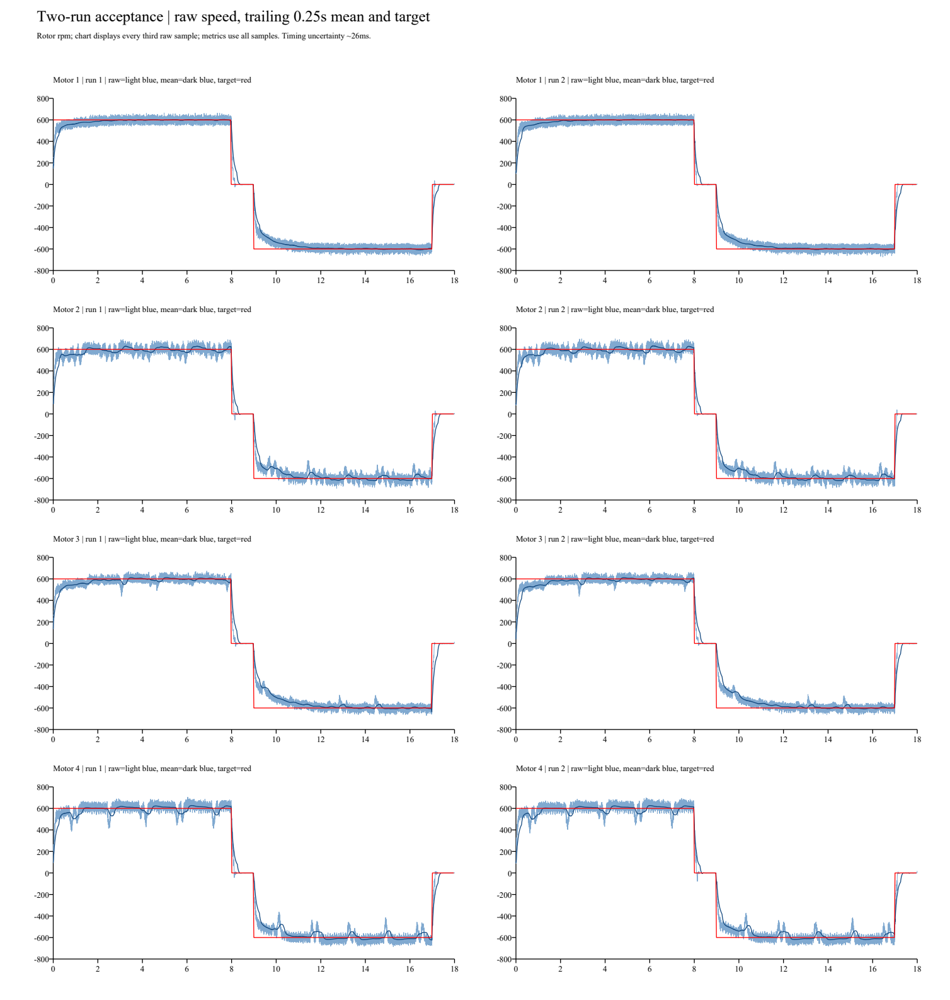

# 第一阶段定量验收与第二阶段进入检查

日期：2026-10-29。第二阶段已开始接续，任务0已完成阈值确认和两轮重复测量；验收结论为未通过，继续第一阶段定位，尚不进入四轮联动。

## 测试前冻结的验收标准

用户在本轮采集前明确确认采用第二阶段计划建议阈值。目标为±600电机转子rpm，保持模式3、Kp=2、Ki=0.004/2ms、积分限幅400、电流指令限幅±1500，正反各8秒、零速各1秒。

| 指标 | 已确认阈值 |
| :--- | :--- |
| 最后2秒平均误差 | 每方向≤2%目标值（12rpm） |
| 最后2秒原始速度标准差 | ≤5%目标值（30rpm）；同时报告极值及95%误差范围 |
| 瞬时超调 | ≤20%；以原始反馈报告，并注明采样限制 |
| 慢响应调节时间 | 0.25秒移动平均进入±5%并保持至段末至少1秒，调节时间≤3秒；另报原始波动 |
| 零速及释放 | 零速末0.5秒反馈绝对值≤5rpm；退出后四路电流指令为零 |
| 重复性 | 固定可靠接线下，每轮完整正反序列至少两次 |

## 本轮条件与完整性

用户已确认底盘架空、2号CAN接线固定、USB-CAN连接及板上固件未改动。本轮未更改固件、PI、目标、限流或方向表；采集器只接收CAN，不发送控制指令。用户通过KEY触发。

- 静止基线60.004秒、275684帧：四轮在线，模式3，29996帧0x200全部为零，无活动/故障诊断。四轮原始反馈峰值绝对值为7/5/6/7rpm，单独保留，不据此更改动作后零速验收标准。
- 第一轮300.047秒、1378654帧、11539条0x1F2，完整1→2→3→4。
- 第二轮180.010秒、827163帧、6923条0x1F2，完整1→2→3→4。
- 两轮共八次完整18秒动作，每轮均有正转、零速、反转、最终零速与释放记录；每个电机恰有两次，两个采集窗口独立，不拼成一次采集。
- 全部状态采样均为在线掩码0x0F、模式3，无反馈不可用/超速故障诊断；本次未实施故障注入，也未另外测试KEY取消，不代替保护专项验收。

## 原始反馈验收结果

| 轮次 | 电机ID | 目标rpm | 末段平均误差 | 原始标准差rpm（限30） | 超调（限20%） | 0.25秒均值调节时间s（限3） | 速度指标 |
| :--- | :--- | ---: | ---: | ---: | ---: | :--- | :--- |
| 1 | 1 | 600 | 0.103% | 29.02 | 10.83% | 1.124 | 达标 |
| 1 | 1 | -600 | 0.044% | 28.74 | 12.33% | 1.876 | 达标 |
| 1 | 2 | 600 | 0.798% | 39.09 | 16.83% | 5.991 | 未达标 |
| 1 | 2 | -600 | 0.264% | 40.20 | 15.83% | 未获得持续保持 | 未达标 |
| 1 | 3 | 600 | 1.057% | 30.79 | 12.17% | 未获得持续保持 | 未达标 |
| 1 | 3 | -600 | 0.170% | 26.16 | 12.00% | 5.676 | 未达标 |
| 1 | 4 | 600 | 0.942% | 43.76 | 17.50% | 未获得持续保持 | 未达标 |
| 1 | 4 | -600 | 0.071% | 42.00 | 14.83% | 未获得持续保持 | 未达标 |
| 2 | 1 | 600 | 0.023% | 29.04 | 11.50% | 1.086 | 达标 |
| 2 | 1 | -600 | 0.025% | 28.22 | 12.33% | 1.850 | 达标 |
| 2 | 2 | 600 | 0.858% | 38.93 | 17.83% | 6.247 | 未达标 |
| 2 | 2 | -600 | 0.208% | 40.26 | 15.83% | 未获得持续保持 | 未达标 |
| 2 | 3 | 600 | 0.775% | 30.58 | 11.83% | 未获得持续保持 | 未达标 |
| 2 | 3 | -600 | 0.098% | 26.07 | 11.00% | 5.939 | 未达标 |
| 2 | 4 | 600 | 0.775% | 42.92 | 17.50% | 未获得持续保持 | 未达标 |
| 2 | 4 | -600 | 1.457% | 49.47 | 14.17% | 未获得持续保持 | 未达标 |

各动作两个零速段末0.5秒的原始反馈绝对值均≤5rpm；每次退出后的检查窗口内四路电流指令均为零。1号第二轮零速峰值达到5rpm边界。非选中电机未出现非零指令。

## 结论与下一步

**未通过第一阶段定量验收，第二阶段运动进入条件未满足。** 1号在两轮样本内满足本表指标；2/4号正反速度标准差持续超标；3号正向标准差30.58～30.79rpm略超30rpm，正反调节时间未达标。四轮全部16个速度段平均误差≤1.458%、超调≤17.834%，仅凭平均跟踪准确不能判为验收通过。

活动段0x200最长间隔≤2.391ms，各阶段选中电机反馈最长间隔≤1.750ms；电流指令绝对值峰值1145，未达到1500限幅，其他轮指令及退出释放检查正常。因此本轮没有支持“明显反馈掉线/指令中断”或“1500限流导致欠速”的证据，不能进一步断言所有物理/电气问题均已排除。

曲线显示2/4号有反复降速，3号也有间歇下降，两轮形态相近；唯一物理根因仍未确定。保持模式3和现有参数，不实现或烧写四轮运动模式来绕过任务0。下一步先在电机断电后检查2/4号轮边接触、线缆拖拽、轴承/减速箱阻力及供电条件，并记录与1号差异；再决定单变量对照。可考虑仅改变转速、比较下降周期是否随转速变化以区分位置相关阻力与固定时间扰动，但该实验尚未执行，不预判结论，不同时加滤波或改PI。

## 计算口径、验证与复现

- 指标使用0x201～0x204原始反馈，非低频0x1F2诊断反馈。每个目标段的末段窗口以该段最后一条诊断时刻为终点，向前取2秒；零速取0.5秒。相对真实切段最多提前约一个诊断周期（约26ms），避免把切零制动混入速度段。调节时间起点同样有约26ms边界不确定性，超调不覆盖第一条诊断前的这段时间；结果应按此采样范围理解。
- 0.25秒移动平均为向后窗口；进入±30rpm并持续到分析段末至少1秒才给出调节时间，未获得时标为未获得，不写成0。标准差采用总体标准差，95%误差范围与极值在JSON中完整保留。
- 绘图仅为显示抽取每第三条原始反馈；全部验收计算使用所有原始样本。移动平均不替代原始波动指标。
- [分析脚本](analyze_acceptance.py)分别生成[第一轮](run1/summary.json)、[第二轮](run2/summary.json)与遥测CSV；[独立校验脚本](verify_acceptance.py)重新读取原始帧，以标准库累加和/平方和复算16个末段均值及标准差，并核对原始计数、采集元数据、八次完整动作，全部一致。
- [绘图脚本](plot_acceptance.py)依赖numpy、reportlab、pypdfium2；[基线检查](check_baseline.py)与[基线结果](baseline_quality.json)单独保留。基线通信检查与动作后零速指标分别判断。
- 原始目录：本地 `_probe/stage1_acceptance_20261029/` 下三个独立目录，准确路径见各轮summary与[归档清单](manifest.json)。本轮合计2481501帧、20769条0x1F2。
- 本地三份ZIP备份位于 `_probe/archives/2026-10-29-stage1-acceptance/`，共17590977字节；压缩包与全部成员SHA-256读回一致。详见[归档脚本](archive_acceptance.py)与清单。原始数据/ZIP仅留本地，报告、脚本、摘要、遥测CSV和曲线入库。

复现命令（将capture路径替换为manifest对应源目录）：

`python analyze_acceptance.py <capture.csv> <输出目录>`

`python verify_acceptance.py`

`python plot_acceptance.py <本报告目录> <第一轮capture.csv> <第二轮capture.csv>`

归档脚本使用独占创建，重复运行需选择新归档目录，禁止覆盖已有数据。
